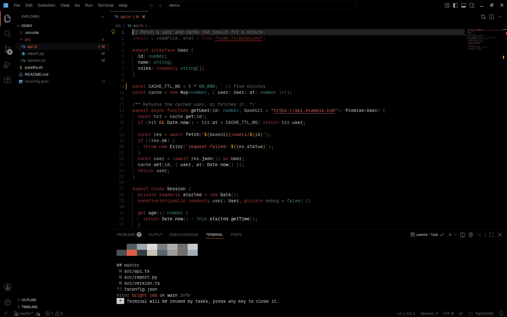
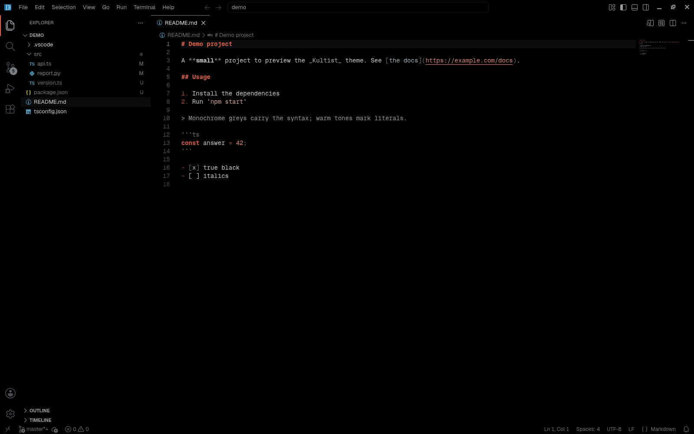
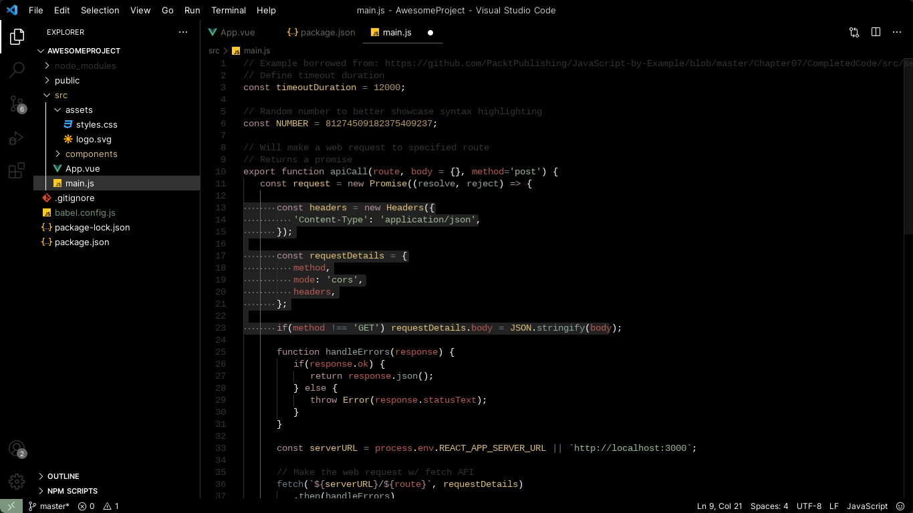

# Kultist color theme

A black and minimal color theme. The workbench uses the
[Solitude](https://github.com/basecamp/omarchy) palette from Omarchy on true black: slate greys,
flat surfaces, with three accents from [ashen](https://github.com/ficcdaf/ashen.nvim): red
`#b14242` and teal `#4a8b8b` at full saturation, gold `#b69759` at half. The editor keeps
ashen's colour roles in that palette: grey structure, red embers for keywords and strings,
muted orange for operators.





## Install

**VS Code**: install from the
[Visual Studio Marketplace](https://marketplace.visualstudio.com/items?itemName=codekult.kultist-color-theme),
or run:

```sh
code --install-extension codekult.kultist-color-theme
```

**VSCodium, Code - OSS, Cursor and other editors that use Open VSX**: install from
[Open VSX](https://open-vsx.org/extension/codekult/kultist-color-theme), or run (with your
editor's CLI, e.g. `codium`, `code-oss`, `cursor`):

```sh
codium --install-extension codekult.kultist-color-theme
```

Then open **Preferences: Color Theme** (`Ctrl+K Ctrl+T`, `Cmd+K Cmd+T` on macOS) and pick
**Kultist**.

## Kultist Classic

Version 2.0 replaced the look of **Kultist**. The original theme (white text on black, with
a subtle [Gruvbox](https://github.com/morhetz/gruvbox) inspired palette) is still included,
unchanged, as **Kultist Classic**. To keep using it, pick it in the theme picker, or set:

```json
"workbench.colorTheme": "Kultist Classic"
```



## Palette

**Editor** (ashen):

| Role | Colour |
| --- | --- |
| Background | `#000000` |
| Text, variables, parameters | `#a5aeb4` |
| Functions, methods | `#d9dbdc` |
| Properties, types | `#cacccc` |
| Comments, brackets | `#707070` |
| Selection | `#343d41` |
| Keywords, decorators, headings | `#b14242` |
| Strings, links | `#df6464` |
| Operators | `#b4866e` |
| Constants, modules, word operators (`in`, `and`) | `#a2755f` |
| Delimiters (`,` `;` `.` `:`) | `#bc976c` |
| Numbers, booleans, builtin types, `this` / `self` | `#4a8b8b` |
| Errors / warnings | `#c53030` / `#b69759` |

**Workbench and integrated terminal** (Solitude on true black): text `#cacccc`, greys
`#343d41` to `#a5aeb4`, slate accent `#798186` (active tab, badges), red accent `#b14242`,
gold warnings `#b69759`. The integrated terminal uses the same 16 ANSI colours as the Kultist
terminal palette.

## Recommended settings

Let the theme style the title bar too:

```json
"window.titleBarStyle": "custom"
```

## Licence

[CC0 1.0](LICENSE.txt): public domain. Use it, fork it, port it.

The editor colours come from [ashen.nvim](https://github.com/ficcdaf/ashen.nvim) by Daniel
Fichtinger (MIT); the workbench palette from Omarchy's Solitude theme.
